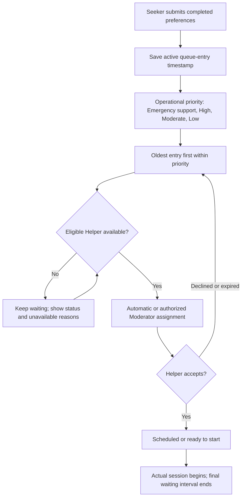
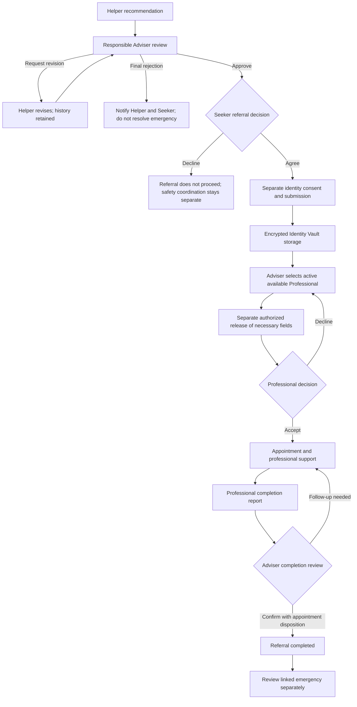
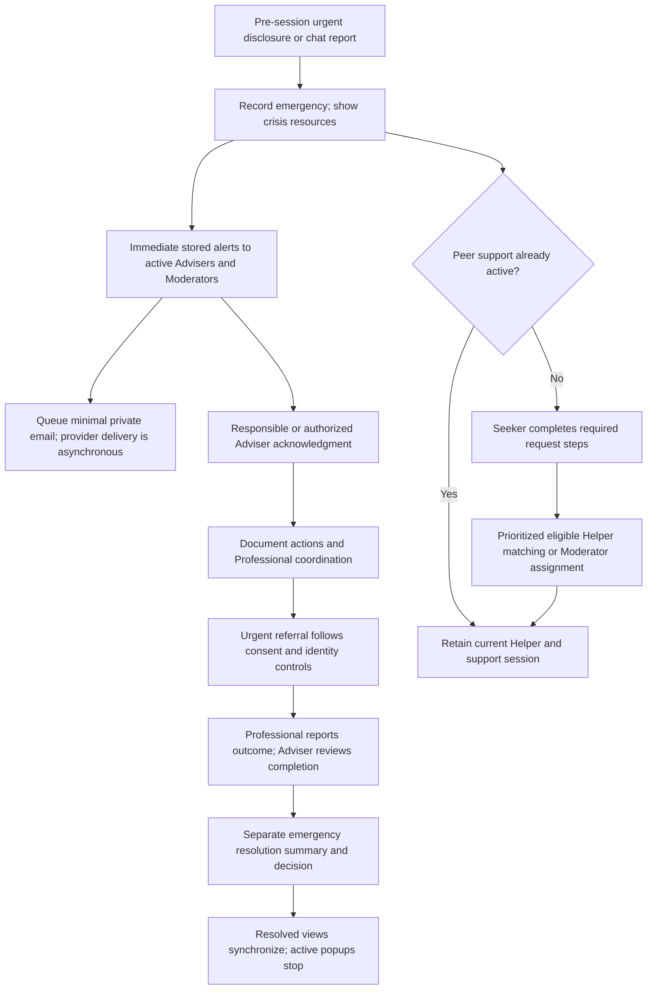

# October 19: queue, escalation and workflow UI validation

## Scope and deployment

This revision keeps existing consent, identity authorization, duty/readiness, one-live-assignment and two-started-sessions-per-duty rules. Original screening answers remain unchanged. Voice and SMS integration are outside this revision.

The additive migration `2026_10_19_000001_add_queue_performance_evidence.php` creates assignment/duty evidence tables and queue reporting markers. Run the normal migration step during deployment. It does not reset or replace existing records. Do not run `migrate:fresh` or reseed the online database.

No new external provider or credentials are required. Existing email, scheduler and optional broadcasting configuration remain necessary for their respective channels. Semester reporting uses `ANALYTICS_SEMESTER_START` and `ANALYTICS_SEMESTER_END`; use custom dates when those are not configured. Keep testing-hours flags appropriate to the deployment.

Assignment and verified duty evidence starts when this revision is installed. Missing historical eligibility/availability is not manufactured. Queue/session records explicitly marked `is_test_record` or linked through `duplicate_of_id` are excluded from performance calculations; ordinary historical/demo records are not silently relabeled.

## Implementation checklist

- One peer-matching permission shared by candidate filtering and final matching, including explicit Adviser approval for High-risk requests.
- Emergency-support queue priority separate from the saved screening classification.
- Incoming Queue and emergency coordination expose live candidates and concrete unavailable reasons.
- Eligible readiness is distinct from full assignment eligibility.
- Manual emergency assignment reuses the transactional matching engine; no eligibility override.
- Existing assignment/acceptance, referral/identity and Professional completion flows retained and regression-tested.
- Adviser final Reject Referral is separate from Request Revision. The older return-for-revision endpoint remains compatible; the final-rejection UI uses the new decline endpoint.
- Shared native dialogs for queue assignment and Adviser review; shared layout/behavior for chat recommendations, emergency reports and completion reports.
- Fixed actions, one scrolling body, mobile field stacking, preserved validation inputs, dirty-form protection, focus return and repeated-submit protection.
- Seeker consent remains separate from identity submission/release; closing a dialog does not record a decision.
- Notification and workflow prompt deduplication, existing bell inbox and active/resolved synchronization retained.
- Dedicated authorized Queue Performance report and CSV, with minimal filters, samples, evidence limitations and separate after-hours waits.

## 1. Ready Helpers and Moderator assignment

Use separate browser profiles/devices for Moderator, Helper and Seeker.

1. Ensure the Helper is active, institutionally verified/training-approved, supervised, and scheduled for the applicable duty.
2. Helper opens **Readiness Check**, completes three breathing rounds, confirms readiness, selects a non-high stress level and Available, then submits.
3. Seeker submits a normal support request while no eligible Helper is free; then make the prepared Helper eligible.
4. Moderator opens **Incoming Queue → Assign Helper**. Candidates refresh every five seconds without replacing a focused selection.
5. Check that the candidate label includes readiness, remaining duty capacity and competency.
6. Open **Unavailable Helpers and reasons**. A readiness-passed Helper may still be off duty, busy, unverified or unsuitable for this particular request.
7. Confirm assignment. Verify the status is awaiting acceptance, then accept from the Helper account and start the session.
8. Attempt a competing assignment from another Moderator tab. It must not create a second live assignment for the same capacity.
9. Test readiness expiry, unavailable preference, occupied capacity, missing supervision and insufficient competency. Each must disappear from eligible options with an explanation and fail final server-side assignment if the form is stale.
10. After two actual session starts in the duty, verify no third assignment becomes eligible. A future appointment does not consume the duty's started-session count but can block an overlapping live session.

Preserve the original queue-entry timestamp after offer decline, expiration or reassignment. Never treat a scheduled/accepted assignment as an actual session start for waiting-time measurement.

## 2. Screening and emergency support

### Single safety question: No

Seeker screening → preferences → queue → eligible Helper assignment → acceptance → start → chat → documentation/evaluation.

### Single safety question: Yes

1. Submit the safety disclosure. The original single-question classification remains High.
2. Verify an emergency coordination alert is recorded and active Advisers/Moderators receive it without waiting for matching.
3. Seeker continues preferences and queue submission. The operational queue priority is Emergency while the screening result remains High.
4. Moderator opens **Emergency Alerts → case coordination → Assign Helper**.
5. Search eligible candidates and assign. Assigned does not mean accepted; acceptance remains explicit.
6. The responsible Adviser acknowledges and documents actions independently of the peer-support session.
7. If there is not yet a submitted support request, show the coordination path; do not invent preferences, consent or a second request.

### Prefer not to say

Retain the review/follow-up workflow. Do not convert the answer to No or automatically give it a new clinical classification. Original answers stay read-only.

### During chat

Helper opens **Emergency**, submits the report, then staff follow the same acknowledgment and coordination process. A live session already has a Helper: do not automatically replace them or create a parallel live assignment. Moderator sees operational information, not transcript or private screening narrative.

If no eligible Helper is available, use **Request Adviser Escalation** immediately; there is no requirement to wait for a reminder interval. Closed, archived or superseded emergencies must reject stale assignment actions.

## 3. Referral and identity

1. Helper opens **Referral** in chat and submits a recommendation.
2. Adviser opens **Referral Queue → case** and chooses one of three separate decisions:
   - **Request Revision:** Helper responds and Adviser reviews again.
   - **Reject Referral:** final reason recorded; recommendation becomes declined and recipients are notified.
   - **Approve Referral:** Seeker receives the referral-consent action.
3. Seeker receives the consent popup during chat. Close it without deciding: consent must remain pending and the Review referral action must still be available.
4. Agree or decline from the Seeker account. Adviser/Helper cannot act on the Seeker's behalf.
5. After agreement, complete the separate **Identity Disclosure Consent** and submit necessary details. The identity step replaces the consent popup, not a nested popup.
6. Adviser selects an active available Professional, then separately authorizes necessary identity fields and the release purpose.
7. Only the assigned authorized Professional can read released information. Repeat the check after a new identity submission or Professional reassignment.
8. Professional accepts and schedules, or declines with a reason for Adviser coordination. An unavailable Professional must produce a pending/reassignment path, not a false completed state.

If chat has ended, use **Referral decisions** for the same pending consent/contact/appointment actions. Declining a referral does not resolve an emergency automatically.

## 4. Professional completion and Adviser resolution

1. Professional opens the accepted/ongoing referral and chooses **Submit completion for Adviser review**.
2. Submit an outcome and any follow-up requirements. Double-click or retry must not create duplicate pending completion reports.
3. Adviser receives the completion notification and reviews the report.
4. Test **Request follow-up** and resubmission.
5. Test confirmation with outstanding appointments/follow-up. Required disposition notes must be enforced; a future appointment cannot simply be marked completed.
6. Confirm the referral completion. A linked emergency remains separately actionable until the Adviser records emergency resolution.
7. Resolve the emergency with a summary. Verify it leaves Active, appears in Completed/Resolved, updates Moderator counts and stops stale emergency popups.

## 5. Modal and notification checks

Check queue assignment, emergency assignment, Helper referral/emergency, Adviser approve/revise/reject, Seeker consent/identity and Professional completion.

- At desktop and phone widths, verify readable labels, full-width mobile fields, no horizontal scrolling, and visible footer actions.
- Only the body scrolls; header/footer stay accessible, including with the phone keyboard open.
- Opening a new workflow does not stack dialogs. Long review/transcript content belongs on the details page.
- Cancel/Escape/backdrop handling must not silently discard edited forms. Closing consent never means agreement/refusal.
- Validation errors preserve entries. Saving disables repeated submits; a failed request permits retry with the original input.
- Keyboard focus enters the dialog and returns to its trigger after closing.
- Important notifications appear centrally; minor updates use side toasts. The bell remains the persistent inbox.
- The same event does not repeatedly pop up after navigation in the same browser/user. New actionable events can generate a new notice. Browser presentation tracking is not a global guarantee across devices.
- Popup dismissal or notification-read status is not emergency acknowledgment or resolution.
- Email delay/failure must not block queue progression or emergency alert creation. SMS is not claimed as implemented.

## 6. Queue Performance report

Moderator/Adviser opens **Reports → Queue performance and assignment metrics**. Use date/semester and optional risk/concern filters. Adviser results are limited to their authorized supervision scope. Export the same filters to CSV.

| Metric | Validation |
| --- | --- |
| Average/maximum waiting | Active queue entry to actual start; start-date cohort; still-waiting rows excluded |
| Utilization | Union of real session intervals overlapping observed verified available duty / union of those duty intervals; busy time stays in the denominator |
| Assignment rate | One final eligible accepted assignment per distinct regularly processed request; failed requests remain in denominator; pending counts shown |
| Emergency response | Identification to first documented authorized acknowledgment; unacknowledged cases shown separately |

Main wait metrics use Monday–Saturday entries from 6 PM to before 10:30 PM PHT. Other entry times are separately counted and averaged. Emergency coordination is excluded from regular assignment rate even when temporary peer support also proceeds.

Risk/concern filters apply to case measures. Utilization describes the authorized Helper pool and date range, independently of those case filters. Helper first-message response is a different KPI from emergency acknowledgment time.

Use known timestamps, repeated offers, final acceptance, declined/expired/cancelled assignments, overlapping intervals, invalid/missing timestamps, test/duplicate markers and after-hours entries. Missing evidence displays No data or a quality count; it is not inferred. These results support operational improvement, not automatic disciplinary decisions.

## Automated checks

- Final local validation, October 19, 2026: **791 PHP tests passed (7,665 assertions)** and **84 JavaScript tests passed**. Production build, Blade compilation and changed-PHP syntax checks passed.
- Browser automation exposed no available browser session. Desktop/phone visual checks and real deployed email/network verification remain manual QA; no screenshots or live-device results are claimed.
- `QueuePerformanceWorkflowTest`: High-risk approval, live emergency candidates, role scope, evidence-based math, exclusions and final referral rejection.
- Existing queue, readiness, consent, emergency distribution/resolution, identity, Professional handoff and completion suites.
- JavaScript tests for shared dialogs, candidate search/refresh, chat workflows, notification presentation and consent.
- Build and compiled Blade validation.

Real deployed email delivery, network/WebSocket behavior and physical-device visual checks remain deployment QA. Local test success is not evidence of those external conditions.

## Flow references for Figures 6 and 7

### Queue priority and assignment

### Referral and completion

### Emergency coordination with continuing peer support

These diagrams describe support coordination, not a guarantee of clinical intervention or external emergency-service arrival. The original single-question Yes classification remains High while operational emergency support is prioritized. Prefer not to say retains the staff review/follow-up route.
